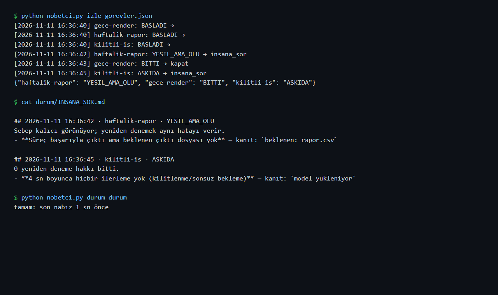

# Nöbetçi (The Watchman): catching jobs that die silently

*Türkçe: [README.md](README.md)*

In the evening I start a long experiment. In the morning I check: either it finished, or it died somewhere around midnight and nobody told me. An error was printed to the screen, but nobody read it. Or the program said "done" and closed, but the file it was supposed to write is not there.

I call this **silent death**. It happened to me several times. At some point I thought, "I shouldn't be the one checking this; a watchman should", and I wrote Nöbetçi.



The question it asks is simple. Not "Are you running?" but **"Are you making progress, and is the result there?"** Those are not the same thing. A program can be open and doing nothing.

## Why I built it: three things that happened to me

| What happened | What was really going on | What Nöbetçi does now |
|---|---|---|
| My overnight video agent kept dying on temporary model-server errors (500), and it took me hours to notice | A temporary error; a retry was enough, but nobody was watching | It recognizes the error, applies the known fix, restarts the job and only leaves me a report (tests 4, 13) |
| An experiment crashed with a GPU error; I noticed hours later | The 4 GB graphics card ran out of memory | It recognizes the error, retries a few times, and asks me if that fails (test 3) |
| An experiment's log stopped at 21:36. I said "it died silently" and restarted it | **It hadn't died; it had finished.** The last line was the last step, and the result file was written in the same minute | "The log went quiet" no longer counts as death on its own. If the result file exists, the job is done (test 7) |

Honestly, I learned the most from the third one. A false alarm is a failure too, because it wastes your time. That is why Nöbetçi decides whether a job is finished by looking at the **result file**, not the log.

## How it works

There are three workers inside. They don't chat with each other; each one writes its work to a file, and the next one picks it up from there. Like a factory line:

```
 watcher ──► state ──► diagnosis ──► chief ──► restart   (reversible job + temporary cause + retries left)
   │                      │             └──► ask me    (everything else)
   │                      └─ backs every claim with a line from the log
   └─ when did the log and the result file last change, and how did the program exit
```

- **Watcher:** describes the job in one of five words.
  - **Running**
  - **Done:** it exited cleanly and the result file is there.
  - **Green but dead:** it said "done", but there is no file. This is the sneakiest failure.
  - **Dead:** it exited with an error.
  - **Stuck:** the program is open, but nothing has changed for a long time.
- **Diagnosis:** finds the cause, and next to each cause it puts the **evidence line** from the log. An AI model can also write a two-sentence summary, but if the summary does not quote a line that appears word for word in the log, it is thrown away. No talking without evidence.
- **Chief:** makes the final decision. Fixed rules that I wrote do this, not an AI model. That is a deliberate choice:
  - If I didn't mark a job as "reversible", it doesn't touch anything.
  - If the cause is permanent (missing file, full disk), it doesn't waste retries; it asks me.
  - If it has used up its retries, it asks me.
- **Remedy catalog:** if it recognizes a known error, it applies a fix I wrote in advance before restarting. Then it **checks** whether the fix actually worked. If it did, it restarts the job and only leaves me a report in `KENDIM_DUZELTTIM.md` ("I fixed it myself"). If it didn't, it does not retry blindly; it asks me.

  | Known error | Fix | Check |
  |---|---|---|
  | Model server returned 500 / crashed from memory (Ollama) | Unload the models from memory (`keep_alive: 0`) | No model left loaded on the server |
  | Out of RAM or GPU memory | Free the memory the model server holds | Same |
  | Lost connection to a service | Wait 30 seconds | The service answers |

  An AI model does not decide on the fix. When I looked into it, this turned out to be the common advice for "self-healing systems": known failures get a pre-approved, reversible action whose result is checked, and AI is used only for diagnosis and new failures.
- **Heartbeat:** Nöbetçi can die too, so on every round it writes the time to a `nabiz` (pulse) file. `python nobetci.py durum <folder>` checks it **from the outside**. A health check that runs inside the thing it checks dies with it; someone else has to watch the watchman.

In short: it fixes the known problems itself, and calls me when something new or risky happens.

## Usage

The shortest way is a single command. No config file; I put Nöbetçi in front of the command I want to run:

```bash
python nobetci.py calistir --cikti result.json -- python experiment.py --rounds 5
```

Everything after `--` is my command, run as is. `--cikti` is the file the job must write when it finishes; Nöbetçi decides "done" by looking at it. It prints a short summary and returns its own exit code: 0 if the job really finished, 1 if not. If the program exits "successfully" but the file is missing, it still returns 1.

```
Nöbetçi: demo_kontrol → BITTI (4 sn)
  log:   .nobetci/loglar/demo_kontrol-20261111-170235.log
  çıktı: demo_raporu.json
```

This output is from a real run: a small script that checks whether my live demos respond (`ornek/demo_kontrol.py`), run under Nöbetçi. All four addresses answered. Note that the script only checks the HTTP response; it does not prove a demo actually answers questions.

| Option | What it does |
|---|---|
| `--cikti FILE` | The job counts as done only when this file exists. Without it, only the exit code is checked, and the summary says so |
| `--geri-alinabilir` | "Reversible": on a transient failure it may restart without asking me. Without it, it touches nothing |
| `--hak N` | How many restarts are allowed (default 2) |
| `--devam "--resume"` | Argument added to the command on restart |
| `--sessizlik SEC` | Seconds without any change before the job counts as stuck (default 600) |
| `--ad`, `--klasor` | Job name and the folder for records (default `.nobetci`) |

Each run gets its own log file, so yesterday's error cannot leak into today's diagnosis. Everything escalated to me accumulates in `.nobetci/INSANA_SOR.md`.

I added this on Nov 11 because I had not used Nöbetçi for three days: writing a config file per job was enough friction that I skipped it when in a hurry.

The config file is still there for watching several jobs together:

```bash
python nobetci.py izle ornek/ytfactory_senaryo.json   # start and watch the jobs
python nobetci.py durum ornek/durum                    # is the watchman alive? (0 = ok, 1 = alarm)
python tests/test_nobetci.py                           # 22 tests (17 failure scenarios + 5 for the single command)
```

Job definition (`ornek/ytfactory_senaryo.json`):

```json
{
  "ad": "ytfactory-senaryo",
  "komut": ["python", "src/ajan.py", "..."],
  "log": "ornek/loglar/ytfactory-senaryo.log",
  "cikti": ".../scenes.spec.json",
  "sessizlik_sn": 900,
  "geri_alinabilir": true,
  "yeniden_hak": 2
}
```

You don't need to touch the code of the program being watched. Telling Nöbetçi three things is enough: which command to run, where the log goes, and which file means the job is "done".

## Tests: each one is a failure that really happened

1. Normal job → Done
2. Exit 0 but no output → Green but dead, ask a human
3. CUDA out of memory → restart twice, then ask a human
4. Model server returns 500 once → restarting saves the job
5. Permanent error (missing file) → no retry
6. Stuck job → killed and diagnosed
7. **Log went quiet but the output was written → counts as done, not dead** (the 21:36 lesson)
8. A non-reversible job is never touched automatically
9. If the watchman's pulse is old, the outside check raises an alarm
10. If the AI "quotes" a line that is not in the log, or quotes nothing, its summary is rejected
11. Model output failed validation → counted as permanent, no retry (the first night's failure)
12. Unknown death → "I don't know" + the last line as evidence
13. **Known error (500) → fix applied, checked, the job restarts and finishes; no human needed, it goes into the report**
14. If the fix can't be confirmed → ask a human
15. On a non-reversible job, no fix is even tried
16. Ollama's well-known memory error ("model requires more system memory") is recognized
17. A generic Python error cannot override a more specific cause such as a 500 (the second real incident)

## Real use: the first night (Nov 8)

I put Nöbetçi in charge of a real job for the first time: the script and scene step of my [ytfactory](https://github.com/emirhnnnk-lab/ytfactory) video agent (`ornek/ytfactory_senaryo.json`).

- After **15 minutes 32 seconds** the job exited with an error. The video agent failed to get its scene recipe through the checks in all 3 tries: one line had 3 highlights and the rule allows at most 2. Nöbetçi caught this and asked me instead of retrying. That was the right call, because retrying with the same input would give the same result.
- **But its own diagnosis was weak.** It didn't know this kind of error. Even so, it made something up ("looks permanent") and gave no evidence line. So the one doing the diagnosis can make things up too. I fixed two things:
  1. I added a new signature: "model output failed validation". This is a permanent cause, because fixing it needs a prompt or rule change.
  2. For a death it doesn't recognize, it now **says it doesn't know** and shows the last log line as evidence.

  I wrote tests for both (11 and 12).
- The actual bug was in the video agent: its repair step didn't fix the number of highlights. That will be fixed separately.

## Second real incident: a bug in the rules (Nov 8, 17:13)
I started a repeatability measurement of my support agent under Nöbetçi. On request 13 the model server returned `500`. Nöbetçi caught the death but **made the wrong decision**. Next to the error there was also Python's generic error line (Traceback). It counted that as a cause too, decided the problem was permanent, and asked me instead of retrying.

The fix: if a more specific cause is found, the generic error line no longer counts as a cause (test 17). I restarted the measurement with the fixed Nöbetçi and the real fixes switched on.

## Limits
- Nöbetçi can't resume a job from where it stopped; the job itself has to know how. When restarting, Nöbetçi can add an argument like `--devam` via `devam_bayragi`.
- The errors it recognizes are limited to the failures I have run into. A new failure type goes into the `IMZALAR` list, and every new signature needs a test.
- It runs on one computer; it doesn't watch jobs spread across several machines.

---
Built by **Emirhan Karaca**
