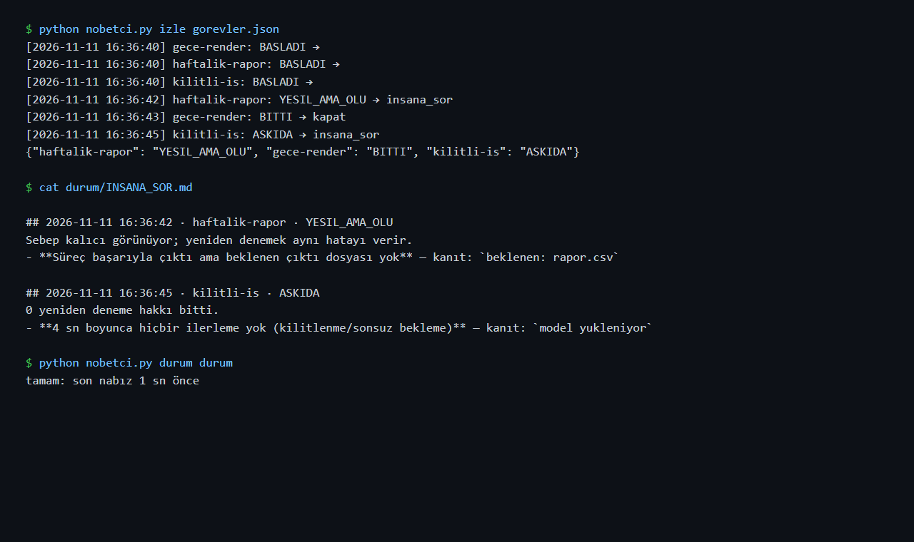

# Nöbetçi: sessizce ölen işleri yakalayan bekçi

> **EN summary:** A small, dependency-free agent system that watches long-running jobs *from the outside*. It catches "silent death" (jobs that are green but dead, or alive but stuck), diagnoses the cause from logs with evidence-backed claims, and auto-recovers only when the job is reversible and the cause is transient. Everything else is escalated to a human. Built after my own ML experiments died silently on a 4 GB GPU machine. 17 failure-scenario tests; known failures are auto-remediated with pre-approved, reversible, verified actions and only reported, all reproduced from real incidents. Full English version: [README.en.md](README.en.md).

Akşam uzun bir deney başlatıyorum, sabah kalkıp bakıyorum: ya bitmiş, ya da gece yarısı bir yerde ölmüş ve kimse bana haber vermemiş. Ekrana bir hata düşmüş ama okuyan olmamış. Ya da program "bitti" deyip kapanmış ama yazması gereken dosya ortada yok.

Buna **sessiz ölüm** diyorum. Benim başıma birkaç kez geldi. Bir noktadan sonra "bunu ben kontrol etmeyeyim, bir bekçi etsin" dedim ve Nöbetçi'yi yazdım.



Nöbetçi'nin sorduğu soru basit: "Çalışıyor musun?" değil, **"İlerliyor musun, sonuç ortada mı?"** Bu ikisi aynı şey değil. Bir program açık durup hiçbir şey yapmıyor olabilir.

## Neden yazdım: başıma gelen üç olay

| Ne oldu | İşin aslı | Nöbetçi şimdi ne yapıyor |
|---|---|---|
| Gece koşan video ajanım model sunucusunun geçici hatalarıyla (500) düşüyordu ve fark etmem saatler sürüyordu | Geçici bir hata; yeniden denemek yetiyordu, ama başında kimse yoktu | Hatayı tanıyor, bilinen çareyi uyguluyor, işi yeniden başlatıyor; bana sadece rapor bırakıyor (test 4, 13) |
| Bir deney ekran kartı hatasıyla düştü; ben saatler sonra fark ettim | 4 GB'lık ekran kartının belleği yetmedi | Hatayı tanıyor, birkaç kez yeniden deniyor, olmazsa bana soruyor (test 3) |
| Bir deneyin kaydı gece 21:36'da kesildi. "Sessizce öldü" dedim, baştan başlattım | **Ölmemişti, bitmişti.** Son satır zaten son adımmış, sonuç dosyası da aynı dakikada yazılmış | "Kayıt sustu" artık tek başına ölüm sayılmıyor. Sonuç dosyası varsa iş bitmiş demek (test 7) |

Açıkçası en çok üçüncüsünden öğrendim. Yanlış alarm da arızadır, insanın vaktini yer. O yüzden Nöbetçi bir işin bitip bitmediğine kayda değil, **sonuç dosyasına** bakarak karar veriyor.

## Nasıl çalışıyor

İçeride üç görevli var. Birbirleriyle sohbet etmiyorlar; her biri işini bir dosyaya yazıyor, sıradaki oradan devralıyor. Bir fabrika bandı gibi:

```
 gözcü ──► durum ──► teşhis ──► şef ──► yeniden başlat  (geri alınabilir iş + geçici sebep + hakkı var)
   │                    │          └──► bana sor          (geri kalan her şey)
   │                    └─ söylediği her şeyi kayıttan bir satırla kanıtlar
   └─ kayıt ve sonuç dosyası en son ne zaman değişti, program nasıl kapandı
```

- **Gözcü:** işin hâlini beş kelimeyle söylüyor.
  - **Çalışıyor**
  - **Bitti:** düzgün kapandı ve sonuç dosyası ortada.
  - **Yeşil ama ölü:** "bitti" dedi ama dosya yok. En sinsi arıza bu.
  - **Öldü:** hatayla kapandı.
  - **Askıda:** program açık, ama uzun süredir hiçbir şey değişmiyor.
- **Teşhis:** sebebi buluyor ve buldukça yanına kayıttan **kanıt satırını** koyuyor. Yapay zekâ isterse iki cümlelik bir özet de yazabiliyor, ama kayıtta birebir geçen bir satırı göstermiyorsa o özet çöpe gidiyor. Kanıtsız konuşmak yok.
- **Şef:** son kararı veriyor. Bunu yapay zekâ değil, önceden yazdığım kurallar yapıyor. Bu bilinçli bir tercih:
  - Bir işin "geri alınabilir" olduğunu ben söylemediysem hiçbir şeye dokunmuyor.
  - Sebep kalıcıysa (dosya yok, disk dolu) boşuna denemiyor, bana soruyor.
  - Deneme hakkı bittiyse yine bana soruyor.
- **Çare kataloğu:** bilinen bir hatayı tanırsa yeniden başlatmadan önce önceden yazdığım bir çareyi uyguluyor. Sonra çarenin gerçekten işe yarayıp yaramadığını **kontrol ediyor**. İşe yaradıysa işi yeniden başlatıyor ve bana sadece `KENDIM_DUZELTTIM.md` dosyasında rapor bırakıyor. Yaramadıysa körlemesine tekrar denemiyor, bana soruyor.

  | Bilinen hata | Çare | Doğrulama |
  |---|---|---|
  | Model sunucusu 500 / bellek yüzünden çöktü (Ollama) | Bellekteki modelleri boşalt (`keep_alive: 0`) | Sunucuda yüklü model kalmadı |
  | RAM ya da GPU belleği yetmedi | Model sunucusunun tuttuğu belleği boşalt | Aynı |
  | Servis bağlantısı koptu | 30 sn bekle | Servis yanıt veriyor |

  Çareye yapay zekâ karar vermiyor. Araştırınca gördüm ki bu, "kendi kendini onaran sistem" konusundaki yaygın önerinin ta kendisi: bilinen arızaya önceden onaylanmış, geri alınabilir ve sonucu kontrol edilen bir eylem uygulanıyor; yapay zekâ ise sadece teşhis ve yeni arızalar için kullanılıyor.
- **Nabız:** Nöbetçi'nin kendisi de ölebilir, o yüzden her turda `nabiz` dosyasına saat yazıyor. `python nobetci.py durum <klasör>` komutu bunu **dışarıdan** kontrol ediyor. İçeriden yapılan sağlık kontrolü, ölçtüğü şeyle birlikte ölür; bekçiyi de bir başkasının kontrol etmesi gerekiyor.

Kısacası: bilinen dertleri kendi çözüyor, yeni ya da riskli bir şey olduğunda beni çağırıyor.

## Kullanım

```bash
python nobetci.py izle ornek/ytfactory_senaryo.json   # görevleri başlat ve izle
python nobetci.py durum ornek/durum                    # nöbetçi yaşıyor mu? (0 = tamam, 1 = alarm)
python tests/test_nobetci.py                           # 17 arıza senaryosu
```

Görev tanımı (`ornek/ytfactory_senaryo.json`):

```json
{
  "ad": "ytfactory-senaryo",
  "komut": ["python", "src/ajan.py", "..."],
  "log": "ornek/loglar/ytfactory-senaryo.log",
  "cikti": ".../scenes.spec.json",
  "sessizlik_sn": 900,
  "geri_alinabilir": true,
  "yeniden_hak": 2
}
```

İzlenen programın koduna dokunmak gerekmiyor. Nöbetçi'ye üç şey söylemek yetiyor: hangi komut çalışacak, kayıt nereye yazılacak ve hangi dosya oluşunca iş "bitti" sayılacak.

## Testler: her biri yaşanmış bir arıza

1. Normal iş → `BITTI`
2. Çıkış 0 ama çıktı yok → `YESIL_AMA_OLU`, insana sorulur
3. CUDA OOM → 2 kez yeniden başlatma, sonra insana sorulur
4. Model sunucusu bir kez 500 veriyor → yeniden başlatma işi kurtarıyor
5. Kalıcı hata (eksik dosya) → yeniden denenmez
6. Askıda kalan iş → öldürülür, teşhis edilir
7. **Log susmuş ama çıktı yazılmış → bitmiş sayılır, ölü değil** (21:36 dersi)
8. Geri alınamaz işe otomatik dokunulmaz
9. Nöbetçinin nabzı eskirse dış kontrol alarm verir
10. LLM, log'da olmayan bir satırı "alıntılarsa" ya da hiç alıntı yapmazsa özet reddedilir
11. Model çıktısı doğrulamayı geçemedi → kalıcı sayılır, yeniden denenmez (ilk gecenin arızası)
12. Tanınmayan ölüm → "bilmiyorum" + son satır kanıt
13. **Bilinen hata (500) → çare uygulanır, doğrulanır, iş yeniden başlar ve biter; insana sorulmaz, rapora yazılır**
14. Çare doğrulanamazsa → insana sorulur
15. Geri alınamaz işte çare bile denenmez
16. Ollama'nın topluluktaki bilinen bellek hatası ("model requires more system memory") tanınır
17. Genel Python hatası, daha belirgin bir sebebin (500 gibi) üstüne yazamaz (ikinci gerçek olay)

## Gerçek kullanım: ilk gece (08.11)

Nöbetçi'yi ilk kez gerçek bir işin başına koydum: [ytfactory](https://github.com/emirhnnnk-lab/ytfactory) video ajanının senaryo ve sahne adımı (`ornek/ytfactory_senaryo.json`).

- **15 dakika 32 saniye** sonra iş hatayla kapandı. Video ajanı sahne tarifini 3 denemede de kontrolden geçirememişti: bir satırda 3 vurgu vardı, kural en fazla 2'ye izin veriyor. Nöbetçi bunu yakaladı ve yeniden denemek yerine bana sordu. Doğru karardı, çünkü aynı girdiyle yeniden denemek aynı sonucu verirdi.
- **Ama kendi teşhisi zayıftı.** Bu hata tipini tanımıyordu. Tanımadığı halde "kalıcı görünüyor" diye uydurdu ve kanıt satırı koymadı. Teşhis eden de uydurabiliyormuş. İki şey düzelttim:
  1. Yeni bir imza ekledim: "model çıktısı kontrolü geçemedi". Bu kalıcı bir sebep, çünkü düzeltmek için prompt ya da kural değiştirmek gerekiyor.
  2. Tanımadığı bir ölümde artık **bilmediğini söylüyor** ve son kayıt satırını kanıt olarak koyuyor.

  İkisi için de test yazdım (11 ve 12).
- Asıl hata video ajanındaydı: onarım adımı vurgu sayısını düzeltmiyordu. O ayrıca düzeltilecek.

## İkinci gerçek olay: kuralın kendi hatası (08.11, 17:13)
Destek ajanının tekrarlanabilirlik ölçümünü Nöbetçi'nin gözetiminde başlattım. 13. talepte model sunucusu `500` verdi. Nöbetçi ölümü yakaladı, ama **yanlış karar verdi**. Hatanın yanında Python'un genel hata satırı (Traceback) da vardı; onu da sebep sayınca durumu kalıcı sandı ve yeniden denemek yerine bana sordu.

Düzeltme: daha belirgin bir sebep bulunduysa genel hata satırı artık sebep sayılmıyor (test 17). Ölçümü düzeltilmiş Nöbetçi ve gerçek çarelerle yeniden başlattım.

## Sınırlar

- Kaldığı yerden devam etmeyi Nöbetçi yapamıyor; bunu izlenen işin kendisi bilmeli. Nöbetçi yeniden başlatırken `devam_bayragi` ile `--devam` gibi bir argüman ekleyebiliyor.
- Tanıdığı hatalar benim karşılaştığım arızalarla sınırlı. Yeni bir arıza tipi `IMZALAR` listesine ekleniyor, her yeni imza bir test istiyor.
- Tek bilgisayarda çalışıyor; birden fazla makineye dağılmış işleri izlemiyor.

---
Geliştiren: **Emirhan Karaca**
